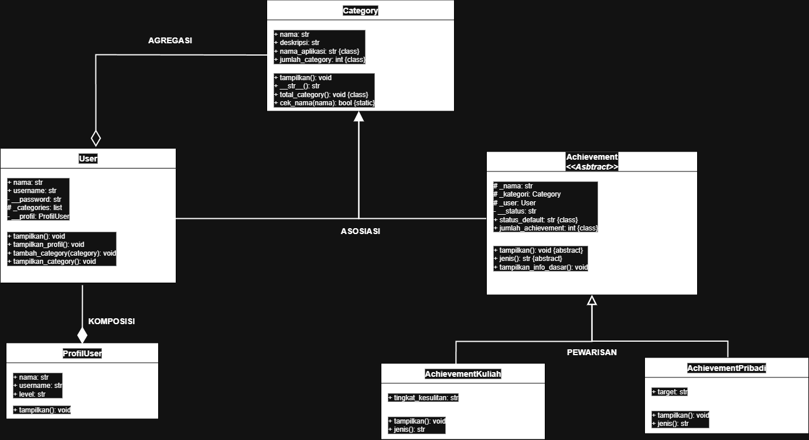
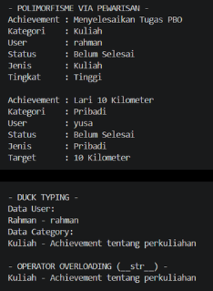
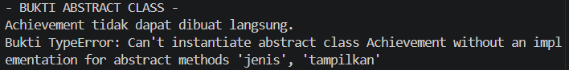
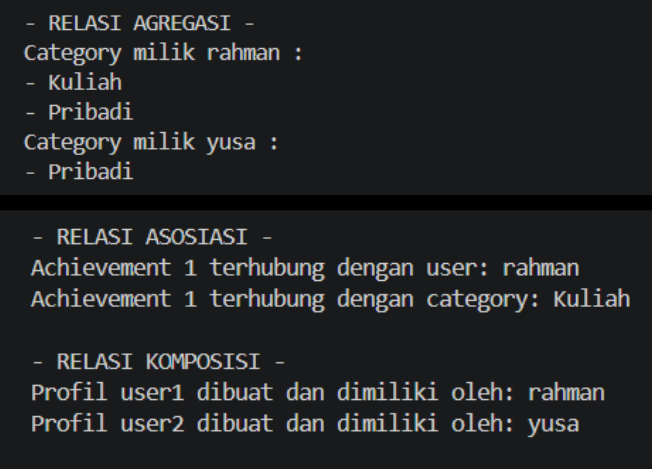
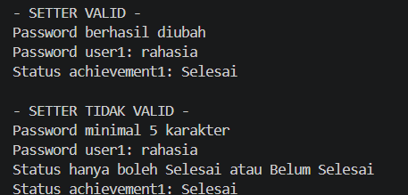

# MyAchivement

MyAchivement adalah program sederhana untuk mencatat achievement pengguna berdasarkan kategori. Setiap achievement dapat berupa achievement kuliah atau achievement pribadi. Program ini mendukung pencatatan target atau tingkat kesulitan, status penyelesaian, serta hubungan antara pengguna, kategori, profil pengguna, dan achievement.

## Class Diagram

### Penjelasan Relasi

- **Asosiasi (Association):** Kelas `Achievement` berhubungan dengan kelas `User` dan `Category`. Setiap objek achievement menyimpan referensi ke pengguna pemilik dan kategori yang dipilih.
- **Agregasi (Aggregation):** Kelas `User` dapat menyimpan beberapa objek `Category` dalam atribut `_categories`. Objek kategori dibuat secara terpisah dan dapat digunakan oleh lebih dari satu pengguna. Hal ini ditunjukkan oleh `category2` yang digunakan oleh `user1` dan `user2`.
- **Komposisi (Composition):** Kelas `User` membuat objek `ProfilUser` secara langsung di dalam konstruktor dan menyimpannya dalam atribut privat `__profil`. Profil tersebut menjadi bagian dari objek pengguna yang memilikinya.
- **Pewarisan (Inheritance):** Kelas `AchievementKuliah` dan `AchievementPribadi` mewarisi kelas `Achievement`. Kedua kelas turunan tersebut mengimplementasikan metode `tampilkan()` dan `jenis()` sesuai kebutuhan masing-masing.

## Abstraksi

Kelas `Achievement` merupakan kelas abstrak yang menggunakan modul `ABC` dan dekorator `@abstractmethod`. Kelas ini memiliki dua metode abstrak, yaitu `tampilkan()` dan `jenis()`, yang wajib diimplementasikan oleh kelas turunannya, yaitu `AchievementKuliah` dan `AchievementPribadi`.

Selain itu, kelas `Achievement` memiliki metode konkret `tampilkan_info_dasar()` untuk menampilkan informasi umum achievement, seperti nama achievement, kategori, pengguna, dan status penyelesaian.

Program juga mencoba membuat objek `Achievement` secara langsung menggunakan blok `try-except`. Percobaan tersebut menghasilkan `TypeError` karena kelas abstrak tidak dapat diinstansiasi sebelum seluruh metode abstraknya diimplementasikan.

## Polimorfisme

Program menerapkan polimorfisme melalui tiga bentuk berikut.

- **Polimorfisme melalui pewarisan:** Kelas `AchievementKuliah` dan `AchievementPribadi` melakukan *override* terhadap metode `tampilkan()` dan `jenis()`. Masing-masing menghasilkan informasi berbeda sesuai jenis achievement. Kedua objek diproses melalui satu perulangan menggunakan `daftar_achievement` tanpa perlu memeriksa jenis objek dengan rangkaian `if/elif`.
- **Duck typing:** Fungsi `tampilkan_data(objek)` memanggil metode `tampilkan()` tanpa mensyaratkan objek berasal dari kelas tertentu. Fungsi ini digunakan untuk objek `User` dan `Category`, meskipun kedua kelas tersebut tidak memiliki hubungan pewarisan satu sama lain.
- **Operator overloading:** Kelas `Category` mengimplementasikan metode khusus `__str__()` sehingga objek kategori dapat langsung ditampilkan menggunakan `print(category1)`. Hasilnya berupa nama kategori dan deskripsinya.

## Prinsip SOLID

Program menerapkan **Open/Closed Principle (OCP)** melalui kelas dasar `Achievement` dan penggunaan perulangan polimorfisme.

Jenis achievement baru dapat ditambahkan melalui kelas turunan yang mengimplementasikan metode `tampilkan()` dan `jenis()`. Dengan demikian, perulangan pemrosesan pada `daftar_achievement` tetap dapat menggunakan pemanggilan `achievement.tampilkan()` tanpa harus diubah untuk setiap jenis achievement baru.

## Fitur OOP Tambahan

Selain konsep utama di atas, program juga menerapkan beberapa fitur pemrograman berorientasi objek berikut.

- **Enkapsulasi:** Atribut seperti `__password`, `__profil`, dan `__status` menggunakan penamaan privat. Atribut `password` dan `status` diakses melalui `@property` serta diubah menggunakan *setter* yang memiliki validasi.
- **Class attribute:** Atribut seperti `nama_aplikasi`, `jumlah_user`, `jumlah_category`, dan `jumlah_achievement` digunakan untuk menyimpan informasi yang berkaitan dengan kelas.
- **Class method:** Metode `info_aplikasi()`, `total_category()`, dan `info_achievement()` digunakan untuk menampilkan informasi tingkat kelas.
- **Static method:** Metode `cek_username()`, `cek_nama()`, dan `Achievement.cek_nama()` digunakan untuk melakukan validasi sederhana tanpa memerlukan objek.
- **Validasi data:** Username harus memiliki minimal tiga karakter. Password baru harus memiliki minimal lima karakter, sedangkan status achievement hanya menerima nilai `Selesai` atau `Belum Selesai`.

## Bukti Output

Jalankan program Python, kemudian ambil tangkapan layar output terminal yang menunjukkan penerapan konsep OOP. Simpan gambar di folder `docs` dan gunakan nama file sesuai dengan gambar yang tersedia.

### Polimorfisme, Duck Typing, dan Operator Overloading

### Bukti Abstract Class Tidak Dapat Diinstansiasi

### Bukti Relasi Antarclass

### Bukti Enkapsulasi dan Validasi

---

**Catatan:** Pastikan semua gambar telah disimpan di folder `docs` dengan nama file yang sesuai agar gambar dapat ditampilkan dengan benar di README GitHub.